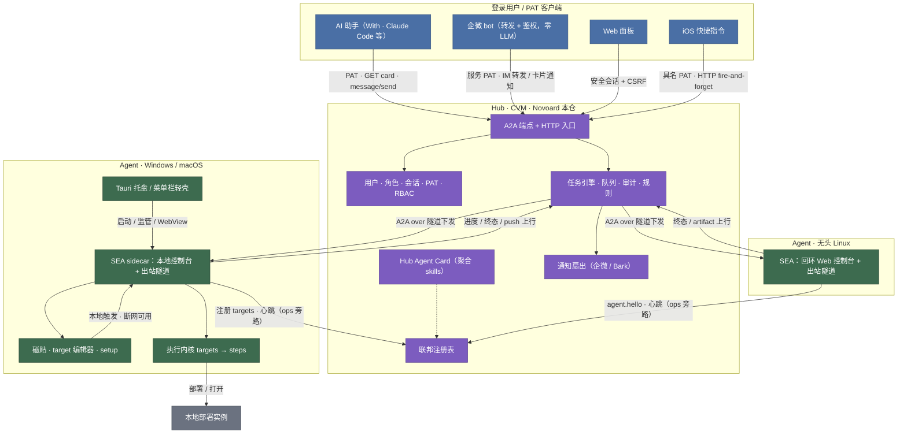

# Novoard 系统架构总览

- 版本：v0.3.4（M9 收官，2026-10-20）
- 相关 ADR：[0002](../adr/0002-novoard-cronkit-boundary.md) [0003](../adr/0003-hub-and-spoke-agent-egress.md) [0004](../adr/0004-a2a-as-common-language.md) [0005](../adr/0005-route-by-definition-table-lookup.md) [0006](../adr/0006-tech-stack-baseline.md) [0007](../adr/0007-cronkit-as-reference-only.md) [0008](../adr/0008-desktop-shell-decision.md) [0009](../adr/0009-hub-management-console.md) [0010](../adr/0010-member-identity-as-ssot.md)
- 桌面载体：本仓 [ADR-0008](../adr/0008-desktop-shell-decision.md) 的外壳选型已由 novoard-agent 仓 ADR-0016 接替（Tauri 壳加托盘），现行记录在 agent 仓。

## 一句话

hub-and-spoke 自动化系统：hub（CVM）做带用户/RBAC 的控制平面，跨平台 agent 做执行平面，cronkit 为参照原型（ADR-0007），A2A 是全系统通用语，路由纪律是“定义时判断，运行时查表”。

## 拓扑

关键点：

- 连接方向：agent 主动外连（WebSocket 出站），任务顺既有连接下发；本地控制台默认只监听回环地址，不开放公网入站，天然穿 NAT。
- 本地闭环：本地触发 → localhost A2A → 执行内核，不出网卡；hub 断连时本机功能仍可用。Windows 系统托盘、macOS 菜单栏和 Linux Web 控制台共用同一个 SEA sidecar。
- 双车道：做工作走 A2A task 生命周期；报状态走 ops 旁路（ping / telemetry / card.update）。
- 通知：hub 扇出到企微 / Bark；A2A push 回推给委派 AI，各走各的。
- 身份边界：浏览器走会话，机器客户端走用户 PAT，agent 走绑定 `agentId` 的独立 token；所有业务入口统一按 RBAC 与 target allow/deny 裁决。
- artifact：上传必须绑定 task/member/target 与 sha256 digest，下载按当前主体的 `artifacts.read` 和 target 范围授权。

## 组件职责

| 组件 | 载体 | 职责 | 不做什么 |
| --- | --- | --- | --- |
| Hub | Novoard 仓，CVM Docker | 身份/RBAC、A2A server/client、HTTP 入口、自动化规则、任务队列、联邦注册表、artifact、审计、通知扇出、Web 管理控制台 | 不做 LLM 语义翻译（翻译在委派方）；不持有 target 定义本体（只持镜像） |
| Agent | 独立 novoard-agent 仓；Windows/macOS Tauri 轻壳 + SEA sidecar，Linux 无头 SEA | 本地控制台与编辑器、Agent Card、localhost A2A、出站隧道、本地 cron、执行内核 | 默认不监听公网入站；不复制 Hub 的用户/RBAC 控制面 |
| 契约 | Novoard `docs/architecture/contracts.md` | target schema、ops 帧枚举、路由表语义 SSOT | 不含实现细节 |

## 数据流：一次远程触发的完整路径

1. 客户端以登录会话或具名 PAT 访问 hub；认证层每次读取当前用户/角色，并计算权限与 target 范围。
2. 客户端 GET hub 的 Agent Card，读有权 skills 决定调谁（hub 零 LLM，skill 枚举即白名单）；`message/send` 经授权后由路由器查表并建 task。
3. 任务引擎选目标 agent，父任务 id 写入 contextId，经隧道下发 JSON-RPC 帧。
4. agent 查本地注册表，命中 target → 执行内核跑 steps（stepTemplates 参数化，语法参照 cronkit 原型）。
5. 若 target `requiresApproval: true` → input-required，审批门沿链双向透传，IM / Web 面板 / 磁贴任一入口可恢复。
6. 步骤级 SSE 进度上行；artifact 由任务 owner agent 带 digest 上传并归属 task；终态 completed/failed 触发通知扇出与 A2A push。
7. 全程事件进审计流水；`audit` 字段决定持久化待遇。

## 部署形态

- hub：腾讯云 CVM Docker 容器，宿主机 nginx 将 `https://novoard.firoyang.com/` 根路径反代到仅绑定 127.0.0.1 的 Hub；React 19 + Ant Design 6 / ProComponents 3 + Vite 7 静态产物随同一镜像交付。
- 企微 bot：CVM，与 hub 同机或独立轻服务（只转发与鉴权，零 LLM）。
- agent：独立 novoard-agent 仓交付，分发形态与桌面壳见该仓 PRD-6（Windows/macOS 均发 Tauri 壳，macOS 为 DMG 且常驻菜单栏，Linux 为无头 SEA）；本仓只管注册行为，三端通过契约 2.1 注册同一 Hub。
- 手机：iOS 快捷指令打 hub HTTP 门，fire-and-forget。

## 非目标

- 不做多 hub 租户 SaaS 或 hub 间联邦；单个 hub 明确支持多个登录用户、内置/自定义角色和具名 PAT。
- hub 不做调度中心：本地 cron 定时留在 agent（ADR-0003 调度归属）。
- 不做任意 shell 远程执行：白名单即 Agent Card skills。
