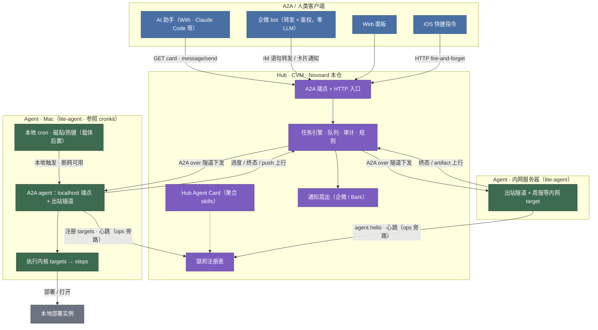

# Novoard 系统架构总览

- 版本：v0.1（M0 文档阶段）
- 相关 ADR：[0002](../adr/0002-novoard-cronkit-boundary.md) [0003](../adr/0003-hub-and-spoke-agent-egress.md) [0004](../adr/0004-a2a-as-common-language.md) [0005](../adr/0005-route-by-definition-table-lookup.md) [0007](../adr/0007-cronkit-as-reference-only.md)

## 一句话

hub-and-spoke 个人自动化系统：hub（CVM）做控制平面，lite-agent（Mac / 内网服务器）等 agent 做执行平面，cronkit 为参照原型（ADR-0007），A2A 是全系统通用语，路由纪律是"定义时判断，运行时查表"。

## 拓扑

关键点：

- 连接方向：agent 主动外连（WebSocket/SSE 长轮询出站），任务顺既有连接下发，agent 侧零入站端口，天然穿 NAT。
- 本地闭环：本地触发 → localhost A2A → 执行内核，不出网卡；hub 断连时本机全功能可用。桌面磁贴/热键形态随载体决策排期（ADR-0007），试点期本地触发以本地 cron 为主。
- 双车道：做工作走 A2A task 生命周期；报状态走 ops 旁路（ping / telemetry / card.update）。
- 通知：hub 扇出到企微 / Bark；A2A push 回推给委派 AI，各走各的。

## 组件职责

| 组件 | 载体 | 职责 | 不做什么 |
| --- | --- | --- | --- |
| Hub | Novoard 仓，CVM Docker | A2A server/client、HTTP 入口、自动化规则、任务队列、联邦注册表、审计、通知扇出、Web 面板 | 不做 LLM 语义翻译（翻译在委派方）；不持有 target 定义本体（只持镜像） |
| agent（lite-agent） | 两台 Mac + 内网服务器（参照 cronkit 原型，ADR-0007） | Agent Card、localhost A2A 端点（桌面形态）、出站隧道、本地 cron、执行内核 | 不监听公网入站；不做服务化（鉴权/暴露留在 hub） |
| 契约 | Novoard `docs/architecture/contracts.md` | target schema、ops 帧枚举、路由表语义 SSOT | 不含实现细节 |

## 数据流：一次远程触发的完整路径

1. 客户端 GET hub 的 Agent Card，读 skills 决定调谁（hub 零 LLM，skill 枚举即白名单）。
2. `message/send` 委派 → hub 路由器查表（skill 在 card → 建 task）。
3. 任务引擎选目标 agent，父任务 id 写入 contextId，经隧道下发 JSON-RPC 帧。
4. agent 查本地注册表，命中 target → 执行内核跑 steps（stepTemplates 参数化，语法参照 cronkit 原型）。
5. 若 target `requiresApproval: true` → input-required，审批门沿链双向透传，IM / Web 面板 / 磁贴任一入口可恢复。
6. 步骤级 SSE 进度上行；终态 completed/failed 触发通知扇出与 A2A push。
7. 全程事件进审计流水；`audit` 字段决定持久化待遇。

## 部署形态

- hub：重庆 CVM（9.134.241.248.devcloud.woa.com）Docker 容器，与 issue-handler 同机共存。对外经 nginx 子目录反代（issue-handler 先例）。
- 企微 bot：CVM，与 hub 同机或独立轻服务（只转发与鉴权，零 LLM）。
- agent：两台 Mac 各跑 lite-agent（dev builder 试点）；内网服务器 lite-agent（周报试点）；桌面 Electron 常驻形态（托盘/热键/磁贴）后置至载体决策（ADR-0007）。
- 手机：iOS 快捷指令打 hub HTTP 门，fire-and-forget。

## 非目标

- 不做多用户 SaaS：个人系统，鉴权只服务自己与自己的 AI 客户端。
- hub 不做调度中心：本地 cron 定时留在 agent（ADR-0003 调度归属）。
- 不做任意 shell 远程执行：白名单即 Agent Card skills。
