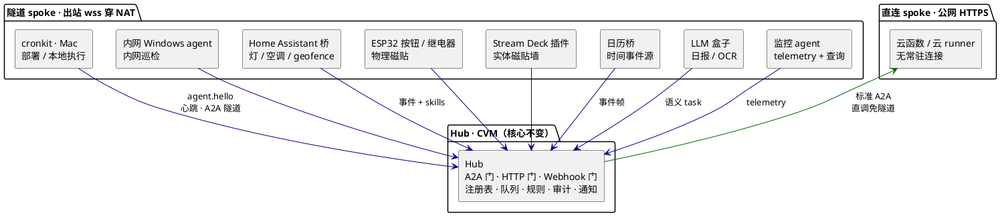

# Research 0003: 扩展形态推演——cronkit 之外还有什么能接

- 日期：2026-10-12（讨论与沉淀同日）
- 结论用途：回答"系统只看到 cronkit 一个 agent，未来还有什么能扩展进来"。为拓扑长期形态、契约演进预留、lite-agent/新成员排期提供依据。非外部调研，是内部推演（对外部参照的引用见 0001/0002）。

## 推演前提

契约对成员的定义只有三条：持有 Agent Card（声明 skills）、说 ops 帧 + A2A JSON-RPC、维持一条到 hub 的连接。满足即合法 spoke。据此打破隐含假设——agent ≠ 一台跑脚本的电脑。推演按"task 里实际在做什么"分四类。

## 四类成员假设

### 感知类（世界 → 系统）

- ESP32 按钮盒：固件直连 wss，按下即上报或触发 skill。物理版磁贴，比软件磁贴更零查找成本。
- 摄像头/传感器节点：移动侦测、温湿度等实时读数做成查询类 skill（查询也是合法 task，读数走 artifact）。
- 日历桥：把"会议前 10 分钟"变成事件流。定时归 agent、hub 只做事件匹配，完全符合 ADR-0003 调度归属纪律。
- Home Assistant 桥：一次接入带来几十个 skills（灯/空调/投影仪）+ geofence 事件（"人到家 → 预热工位 Mac 部署"）。

### 动作类（系统 → 世界）

- HA 桥反向：target steps 从 shell 命令变成 API 调用，"睡前关全部灯"即普通 target。
- ESP32 继电器：硬重启路由器、物理按键等软件做不到的动作。
- Stream Deck 插件：物理键映射 skill，PRD-1 磁贴概念的实体化。

### 执行机器类（cronkit 同类换环境）

- 公司内网 Windows 机：与工位 Mac 完全同模式，出站穿 NAT 天然适用内网；skills 为内网巡检、办公工具链。
- Android 手机：Termux 常驻可做二等 agent；iOS 受后台限制只能做事件源 + 低频动作端（捷径触发时短连上报），是二等公民但不是不能接。修正"手机永远不做 agent"的早先判断。

### 语义类（带 LLM 的边缘）

- LLM 盒子/日报 agent：skill 声明"每天 8 点读 hub 审计流水，总结日报推企微"。"hub 零 LLM"纪律说语义翻译在委派方，委派方完全可以是执行平面里带 LLM 的成员——语义工作下沉到 spoke，hub 核心一行不改。
- OCR/分类 agent：task 传入图片 artifact，返回识别结果，给其他 target 当步骤输入。
- 人工节点（card 泛化）：把 PRD-4 审批门泛化——card 声明 skill"需人眼确认的审核"，task 派给人，人的回复即 artifact。同构于 input-required，只是审批泛化成人工步骤。

## 传输变体：对契约 §4 的挑战

- 云函数/Serverless runner：无常驻连接但有公网端点，hub 直接作为 A2A client 调 `message/send`，免隧道。这是 A2A 通用语最自洽的用法：隧道只是 NAT 世界的传输变体，公网成员天然免隧道。
- 低功耗设备：会话式 spoke——醒来 → hello → 拉队列 → 执行 → 上报 → 睡。ops 帧不变，仅连接策略变体。

## 扩展后拓扑

## 契约层面需要的演进

大部分成员零改动注册即接入（授权矩阵天然管住），只有三处需要演进：

1. ops 枚举新增事件上报帧（如 `event.report`）——走"枚举封闭、新增即契约变更"既定流程；过渡期可先塞 `telemetry` 载荷。
2. 契约 §4 传输放宽为"长连接或公网直连或会话式"。
3. Agent Card 生成规则补一句：skills 语义允许查询类/人工类 task。

## 判断

感知类与语义类是 Novoard 与"又一台 runner"的分水岭——系统从"远程跑脚本"变成"个人环境的数字神经"。执行机器类只是水平扩容，感知与语义才改变系统的性质。

## 明确不做（非目标重申）

- mesh（agent 互联）：0002 定性为 early adopter 风险，星型保持。
- hub 之间联邦：多租户是非目标。
- iOS 作为常驻 agent：后台限制，只做事件源与动作端。

## 来源

内部推演，无外部新引用。外部参照见 [0001](0001-market-scan.md)（产品形态）与 [0002](0002-hub-references-and-a2a.md)（hub-and-spoke 与 A2A 协议）。
